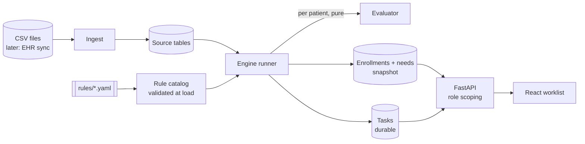

# Architecture

## Components

* **Ingest** loads CSVs into source tables, drops exact duplicates and skips bad rows
  with a report instead of failing the load.
* **Engine core** (`engine/`) is pure Python. `evaluate_patient(context, catalog,
  as_of)` returns enrollments, needs and draft tasks with no database or web
  imports, so it is easy to test and to parallelize.
* **Runner** is the only bridge between the database and the engine. It replaces
  the derived snapshot and reconciles tasks.
* **API** serves stored results and never recomputes rules on a request.
* **Frontend** sends the selected role. Its types are generated from the OpenAPI
  schema.

Everything runs in one process today (the API seeds and runs the engine on first
start), but the boundaries are where separate services would split.

## Data model

| Group | Tables | Lifecycle |
|---|---|---|
| Source | `patients`, `diagnoses`, `lab_results`, `encounters` | Written by ingest, later by EHR sync |
| Runs | `engine_runs`: as-of date, rules hash, counts | One row per run, kept |
| Snapshot | `enrollments`, `needs`, `need_sources` | Replaced each run. A pure function of data, rules and date |
| Work | `tasks` | Durable. Upserted by `task_key`, auto-resolved when no longer needed |

A need is generic (`need_type`, `target`, `cadence_days`, `priority`), so new need
types need no schema change. `need_sources` records which program and tier asked
for a need, so one need can serve several programs. Enrollments store readable
evidence ("HbA1c 9.4 on 2026-01-12 (>= 9.0)"), so staff can see why a patient is
on a list.

`task_key = patient | need_key | task_type | cycle` (cycle is the due date, or
`first-visit` for referrals). Re-runs never duplicate tasks, and open tasks whose
need is now scheduled or done are resolved with a reason.

## Key decisions

**Programs are data.** Each program is a YAML file: eligibility, then ordered tiers
(first match wins, a tier with no `when` is the default), each listing its needs.
There is no program-specific code.

**Two small registries, not a general rules DSL.** *Conditions* (`all`, `any`,
`not`, `age_gte`, `age_lt`, `has_diagnosis`, `latest_lab`, `no_recent_lab`)
validate their parameters at load time and return a function of `(patient,
as_of)`. *Need types* (`visit`) decide a need's status (scheduled, up to date,
overdue, never seen) and the task that status calls for. A generic expression
language (JSONLogic, CEL) is more flexible but harder to validate and to explain to
clinicians. With registries, new criteria are a few lines of Python, and a typo
fails at startup with a path like `diabetes_management.tiers[1].needs[0]: unknown
specialty 'Endo'`.

**Explicit as-of date.** Rules never call `date.today()`. Runs are reproducible,
tests can pin edge cases, and snapshot data like the provided CSVs evaluates
correctly.

**Overlapping needs merge.** One need per patient, type and target: the shortest
cadence and highest priority win and all sources are kept. A diabetic with
hypertension gets one Cardiology task, not two.

**Role scoping on the server.** `api/roles.py` maps roles to visible task types, and
every query intersects that with the requested filters.

**Corners cut**
* Full recompute per run. That takes about 10 ms for 300 patients, but it is not
  how this should work at scale (see below).
* The snapshot is replaced, not versioned, so there is no "list as of last week".
* No task actions (claim, complete, dismiss). The status fields exist, but there is
  no write API.
* The role comes from a header, standing in for an auth token claim.
* SQLite locally. Queries avoid dialect-specific SQL, but I have not run them on
  SQL Server.

## Extending

**New program:** add `rules/programs/<id>.yaml`. `tests/test_extensibility.py` adds
a hypertension program this way, with no code changes.

**New need type, e.g. lab orders:**
1. `engine/needs.py`: add `LabOrderNeed` with `target_field = "test"`. `assess`
   reads `ctx.labs_for(test)` instead of encounters. `task_for` returns a
   `lab_order` task when the last result is missing or older than the cadence.
   Register it in `NEED_TYPES`.
2. YAML, e.g. in the Unmonitored tier:
   `{ type: lab_order, test: HbA1c, every_days: 90, priority: high }`.
3. `api/roles.py`: add `lab_order` to the roles that should see it.
4. Regenerate frontend types. The worklist renders any task type.

The schema, evaluator and queries do not change.

## Scaling

**More programs.** Index programs by trigger (diagnosis family, age band, lab test),
so each patient is only checked against programs that could apply. Rules are
already content-hashed on each run. Add a preview step that dry-runs a rules change
and diffs task counts before it ships.

**Millions of patients.** Patients are independent, so the work parallelizes
cleanly. Evaluation is about 35 µs per patient, so I/O dominates, not rules.
* Incremental runs: a new encounter, lab or diagnosis enqueues that patient ID, and
  a worker re-evaluates only that patient. A nightly run catches time-based changes,
  and could be limited to patients whose earliest due date has passed.
* Workers pull ID batches from a queue, bulk-load contexts, evaluate and bulk-write.
* Composite indexes are already in place. Partition tasks by status or facility,
  keep the worklist as a read model, and cache hot worklist queries in Redis.

**On Azure:** API on Container Apps. Engine workers and the nightly run as
Container Apps jobs fed by Service Bus. Azure SQL. Azure Cache for Redis. Frontend
on Static Web Apps. Azure DevOps Pipelines and Terraform for CI/CD and
infrastructure.

## EHR integration

* **Inbound:** an adapter upserts source tables from the EHR (FHIR or vendor API)
  and emits a patient-changed event.
* **Outbound booking:** write an outbox row in the same transaction as the task
  update. A worker sends it with an idempotency key, retries with exponential
  backoff and jitter, and dead-letters repeated failures. The task shows "booking
  pending" until the EHR confirms.
* **Consistency:** the EHR is the source of truth. Webhooks or polling reconcile
  appointments, and the next engine run resolves the task once the booked encounter
  appears.
* **LLM summaries for coordinators** can be grounded in the evidence the engine
  already stores, rather than generated from raw charts.

## With more time

Task actions and an audit trail, incremental evaluation, the lab-order need type, a
rules preview and diff tool, SQL Server in docker-compose for local parity, and
Dockerfiles.
